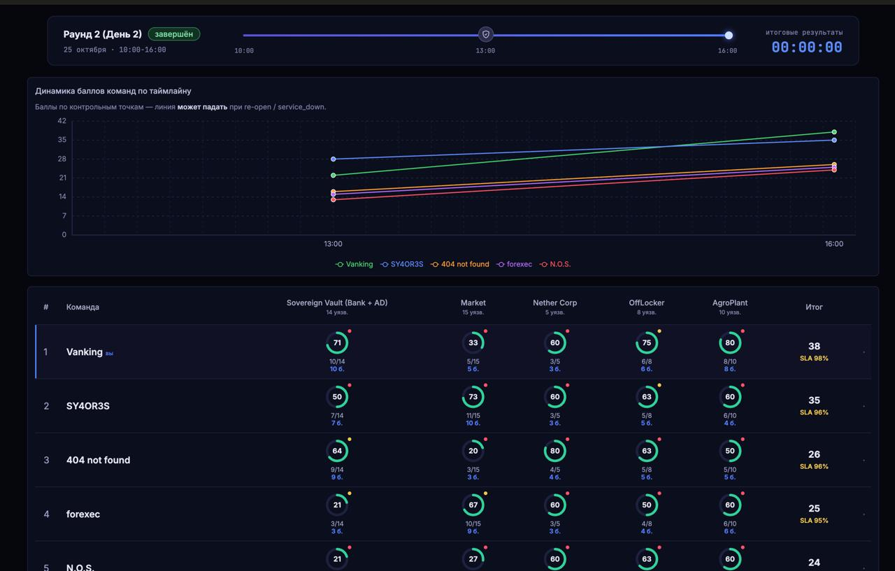

# uzumhakaton — внешняя защита пяти учебных сервисов (команда Vanking)

Защитный трек хакатона: пять намеренно уязвимых сервисов нужно было закрыть **внешними средствами**,
не меняя код приложений, и сохранить работу легитимных клиентов. Итог раунда 2 — **1-е место, 38 баллов,
SLA 98 %**, 32 из 52 пунктов: Sovereign Vault 10/14, Market 5/15, Nether Corp 3/5, OffLocker 6/8, AgroPlant 8/10.

## Что внутри

| Каталог | Назначение |
|---|---|
| `agro/` | Modbus/TCP-шлюз AgroPlant (6005 → 5005): структурный allowlist, FC22 read-modify-write под lock, водяной тракт насоса, дозирование, частотные правила, чтения телеметрии вне write-lock; тесты |
| `offlocker/` | SBE-шлюз OffLocker (6004 → 5004): allowlist кадров, URL/XML/путь/подпись, владение ячейкой через MyParcels, пейсинг входа по PIN, `ErrorResponse 120` вместо разрыва; тесты; прежний шлюз для отката |
| `web/` | Политика и mitmproxy-addon за SafeLine для Vault / Market / Nether: allowlist JSON-полей, суммы, JWT alg, Host/Origin, служебные endpoint'ы, расширения загрузок; тесты и интеграция с реальным mitmproxy |
| `sla_smoke.py` | Проверки штатных клиентских сценариев (PASS/FAIL/CONF/SKIP/SLOW) |
| `audit_tools/` | Offline replay захватов, сравнение со старым шлюзом, разбор Modbus-телеметрии |
| `*.json`, `*.csv` | Реестр находок (50 записей), критерий строгого подсчёта, evidence-сводки (обезличены) |
| `docs/` | Скриншот результатов |
| `BUILD_SUMMARY_RU.md`, `SOURCES_TAKEN.md` | Что выбрано и исправлено; происхождение файлов |

## Принципы

- **Allowlist структуры, а не blacklist сигнатур.** Сигнатурный WAF закрывает инъекции; бизнес-логика
  (отрицательная сумма, чужая ячейка, насос при закрытом клапане) закрывается только правилами,
  которые понимают протокол и состояние.
- **Ничего не ломать.** Политика проверена на 27 598 легитимных HTTP-запросах из захвата, Modbus-шлюз —
  на 69 документированных запросах (384 ответа байт-в-байт), 60 юнит/транспортных + 6 интеграционных тестов.
- **Откат за секунды.** Спорные правила вынесены на флаги (`--duplicate-limit`, `--change-limit`,
  `--no-value-bounds`), web — возврат upstream, OffLocker — прежний шлюз.
- **Честная граница.** Что подтверждено, что частично, что требует изменений в коде продукта — разделено
  в реестре (`audit_findings.json`, `evidence_count.json`).

## Ограничения

Защита AD/FTP/SSH (нет портов 60xx) и бизнес-логика, требующая знания владельца объекта (IDOR, платёжный
callback, корзина), внешними средствами не закрываются — зафиксированы как backlog для владельца продукта.
Все внутренние адреса стенда в материалах заменены на `STAND_HOST`.
