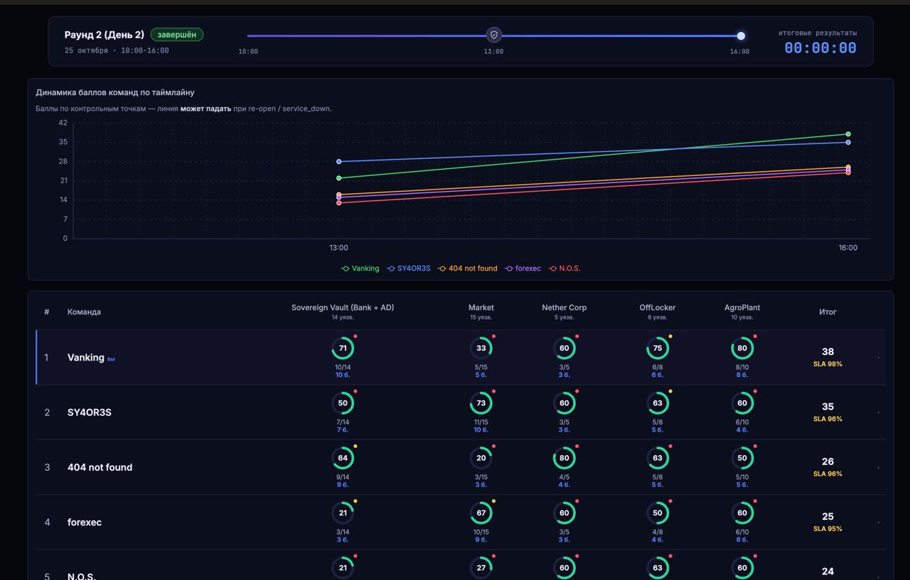

# uzumhakaton — внешняя защита пяти учебных сервисов

Набор шлюзов и политик, которыми команда **Vanking** закрывала пять намеренно уязвимых сервисов на защитном треке
CyberSecurity Uzum Hackathon (24–25 октября 2026), не меняя код самих приложений.

**Итог раунда 2 — 1-е место: 38 баллов, SLA 98 %, закрыто 32 из 52 пунктов.**



> **In English.** External defence for five intentionally vulnerable training services (a bank with AD, a marketplace,
> a corporate portal, a parcel-locker network and an agricultural plant controller) built by team Vanking for the defensive
> track of the CyberSecurity Uzum Hackathon, 24–25 Oct 2026. Application code could not be changed, and every rule was
> scored both on attacks stopped and on legitimate clients kept working. Round 2 result: 1st place, 38 points, SLA 98%,
> 32 of 52 items closed. Protocol-aware allowlists: a mitmproxy policy behind SafeLine for the web services, an SBE gateway
> for the lockers, a Modbus/TCP gateway for the plant. Russian is the working language of this repository.

Разбор кейса: [dmitriy.cv/ru/work/uzum-hackathon](https://dmitriy.cv/ru/work/uzum-hackathon/) ·
[English](https://dmitriy.cv/work/uzum-hackathon/)

## Задача

Пять сервисов стенда: банк с Active Directory (Sovereign Vault), маркетплейс (Market), корпоративный портал (Nether Corp),
сеть постаматов (OffLocker) и контроллер агрокомплекса (AgroPlant). Условия:

- защищать можно только **внешними средствами** — код приложений остаётся как есть;
- каждое правило оценивается дважды: по атакам, которые оно остановило, и по **SLA** — работе легитимных клиентов.

Правило, которое блокирует атаку и заодно клиента, отнимает баллы. Поэтому каждое правило проверялось на реальном
трафике до включения.

## Результат

| Сервис | Закрыто | Чем закрывали |
|---|---|---|
| Sovereign Vault (банк + AD) | 10 / 14 | `web/` — политика за SafeLine |
| Market | 5 / 15 | `web/` — политика за SafeLine |
| Nether Corp | 3 / 5 | `web/` — политика за SafeLine |
| OffLocker | 6 / 8 | `offlocker/` — SBE-шлюз |
| AgroPlant | 8 / 10 | `agro/` — Modbus/TCP-шлюз |
| **Итого** | **32 / 52** | 38 баллов, SLA 98 % |

Самый слабый результат — Market. Почему и что осталось открытым, см. [Ограничения](#ограничения).

## Как устроен контур

Клиенты стенда ходят на публичные порты `60xx`, приложения слушают `50xx`. Между ними стоит наш слой, который понимает
протокол и состояние и пропускает только то, что описано как корректный запрос.

```
                    публичный порт            наш слой                         приложение
 Vault    клиент ──▶ 6001 ──▶ SafeLine ──▶ mitmproxy + web/policy.py ──▶ 5001
 Market   клиент ──▶ 6002 ──▶ SafeLine ──▶ mitmproxy + web/policy.py ──▶ 5002
 Nether   клиент ──▶ 6003, 6006 ▶ SafeLine ▶ mitmproxy + web/policy.py ──▶ 5003, 5006
 OffLocker клиент ─▶ 6004 ───────────────▶ offlocker/offlocker_gw.py ──▶ 5004   (SBE поверх TCP)
 AgroPlant HMI ───▶ 6005 ───────────────▶ agro/modbus_gw.py ──────────▶ 5005   (Modbus/TCP)
```

| Компонент | Что делает |
|---|---|
| `web/policy.py`, `web/guard_addon.py` | Allowlist JSON-полей, проверка сумм, алгоритм JWT, Host/Origin, служебные endpoint'ы, расширения загрузок. Работает как addon mitmproxy в reverse-режиме за SafeLine; если addon не загрузился, прокси отвечает 403 на всё (fail-closed). |
| `offlocker/offlocker_gw.py` | Allowlist кадров SBE, проверка URL / XML / пути / подписи, владение ячейкой через MyParcels в том же upstream-соединении, пейсинг входа по PIN, `ErrorResponse 120` вместо разрыва соединения. |
| `agro/modbus_gw.py` | Структурный allowlist Modbus, FC22 read-modify-write под lock, водяной тракт насоса, лимиты дозирования, частотные правила, чтение телеметрии вне write-lock. |
| `sla_smoke.py` | Проходит штатные клиентские сценарии по всем пяти сервисам и по каждому выдаёт `PASS`, `FAIL`, `CONF`, `SKIP` или `SLOW`. |

## Быстрый старт

Юнит-тесты работают на стандартной библиотеке, без установки зависимостей. Проверено на Python 3.11 и 3.14.

```bash
git clone https://github.com/Vanking-UZ/uzumhakaton.git
cd uzumhakaton

(cd agro && python3 -m unittest -q)        # 19 тестов
(cd offlocker && python3 -m unittest -q)   # 19 тестов
(cd web && python3 -m unittest -q)         # 13 тестов
python3 -m unittest -q test_sla_smoke      # 9 тестов
```

Интеграция web-политики с настоящим mitmproxy (версия закреплена в `web/requirements.txt`, проверено на Python 3.11):

```bash
python3.11 -m venv .venv && . .venv/bin/activate
pip install -r web/requirements.txt
(cd web && python integration_web.py)      # 6 тестов: поднимает mitmdump и тестовый origin на loopback
```

Проверено 17 ноября 2026: 60 юнит-тестов проходят на Python 3.11 и 3.14, 6 интеграционных — на Python 3.11 с
mitmproxy 10.4.2.

## Запуск шлюзов

Шлюзы слушают loopback и по умолчанию используют внутренние порты `160xx`, чтобы их можно было поднять рядом с
действующим контуром и переключить трафик отдельно.

```bash
# AgroPlant: Modbus/TCP, по умолчанию 127.0.0.1:16005 -> 127.0.0.1:5005
python3 agro/modbus_gw.py --port 16005 --upstream-port 5005

# OffLocker: SBE, по умолчанию 127.0.0.1:16004 -> 127.0.0.1:5004
python3 offlocker/offlocker_gw.py --port 16004 --upstream-port 5004

# Web: vault | market | nether, mitmproxy в reverse-режиме перед origin
python web/run_guard.py vault --port 16001 --origin-port 5001 --public-host STAND_HOST:6001
```

Спорные правила AgroPlant вынесены на флаги, чтобы слишком строгое правило откатывалось за секунды:

| Флаг | Что отключает или меняет |
|---|---|
| `--duplicate-limit N` | сколько одинаковых записей допускается за 2 с; `0` отключает правило |
| `--change-limit N` | сколько изменений регистра допускается за 1 с; `0` отключает правило |
| `--no-value-bounds` | отключает документированные диапазоны уставок; структурные правила, водяной тракт и FC22 остаются |
| `--timeout`, `--lock-timeout`, `--idle-timeout` | таймауты ответа backend, ожидания write-lock и простоя клиента |

Откат остальных слоёв: web — вернуть upstream напрямую, OffLocker — прежний шлюз
(`offlocker/legacy_offlocker_gw_reference.py`).

Проверка штатных сценариев через шлюзы или напрямую по origin:

```bash
cp sla_config.example.json sla_config.json   # учётные данные — в этот файл или в SLA_VAULT_USERNAME / SLA_VAULT_PASSWORD
python3 sla_smoke.py --config sla_config.json --mode gateway
python3 sla_smoke.py --config sla_config.json --mode origin --assets vault,market
```

`sla_config.json` в `.gitignore`. Режим `--full` меняет состояние сервисов; вместе с `--repeat` он требует явного
`--allow-repeated-full`.

## Что в репозитории

| Путь | Назначение |
|---|---|
| `agro/` | Modbus-шлюз AgroPlant, его тесты и данные протокола: документированные сценарии, фазы инцидента, эталон для replay |
| `offlocker/` | SBE-шлюз OffLocker, тесты, прежний шлюз для отката |
| `web/` | Политика, addon и запуск mitmproxy для Vault / Market / Nether; юнит- и интеграционные тесты |
| `sla_smoke.py`, `test_sla_smoke.py`, `sla_config.example.json` | Проверка штатных клиентских сценариев и её тесты |
| `audit_tools/` | Offline replay захватов, сравнение с прежним шлюзом, разбор Modbus-телеметрии |
| `audit_findings.json`, `audit_findings.csv` | Реестр находок, 50 записей |
| `evidence_count.json` | Критерий строгого подсчёта подтверждённых сценариев |
| `offline_evidence.*`, `legacy_comparison.json`, `large_pcap_sweep.json`, `market_business_evidence.json`, `offlocker_capture_summary.json` | Сводки по результатам replay и разбора захватов, обезличены |
| `BUILD_SUMMARY_RU.md` | Что вошло в финальную сборку и какие 12 дефектов в ней исправлены, с регресс-тестами |
| `SOURCES_TAKEN.md`, `FILE_HASHES.sha256` | Происхождение и хэши файлов пакета |
| `docs/img/` | Итоговая таблица раунда 2 |

Инструменты из `audit_tools/` читают захваты трафика стенда (`.pcap`). Сами захваты в репозиторий не входят, поэтому без
них replay не запустится; его результаты лежат в файлах сводок.

## Принципы

- **Allowlist структуры, а не blacklist сигнатур.** Сигнатурный WAF закрывает инъекции. Бизнес-логику — отрицательную
  сумму перевода, чужую ячейку постамата, насос при закрытом клапане — закрывают только правила, которые понимают
  протокол и состояние.
- **Ничего не ломать.** Каждое правило проверяется на легитимном трафике до включения.
- **Откат за секунды.** Спорные правила вынесены на флаги, у каждого слоя есть путь назад.
- **Честная граница.** Что подтверждено, что закрыто частично и что требует изменений в коде продукта, разделено в
  реестре.

## Как проверяли, что ничего не сломано

| Проверка | Результат |
|---|---|
| Web-политика на захвате трафика | 27 598 легитимных HTTP-запросов пропущено, 336 отклонено |
| Modbus-шлюз на 69 запросах из руководства к установке (45 штатных, 24 сервисных) | 384 ответа совпали байт-в-байт |
| Юнит- и транспортные тесты | 60: agro 19, offlocker 19, web 13, smoke 9 |
| Интеграция с mitmproxy | 6 из 6 |
| Сравнение с прежним шлюзом OffLocker | 3 записи: прежний пропускал, новый отклоняет |

Перед финальной сборкой собственные шлюзы прошли ревизию: исправлено 12 дефектов, у каждого есть регресс-тест.
Список — в [`BUILD_SUMMARY_RU.md`](BUILD_SUMMARY_RU.md).

## Реестр находок

`audit_findings.json` — 50 записей по Vault, Market, Nether, OffLocker, AgroPlant и инфраструктуре. Для каждой указаны
доказательство, внешняя мера и статус. `evidence_count.json` выделяет из них консервативное подмножество с прямо
зафиксированным результатом на стороне сервера.

Число подтверждённых сценариев в этом подмножестве и число закрытых пунктов в таблице организаторов совпадают — оба
равны 32, — но это **разные величины**: первое считает сценарии атак, найденные в захватах, второе — пункты
проверяющей системы. Соответствия один к одному между ними нет, и `evidence_count.json` это прямо оговаривает.

## Ограничения

- **Market — 5 из 15.** Логику, которая требует знать владельца объекта (IDOR, платёжный callback, корзина), снаружи
  приложения закрыть нельзя. Эти пункты записаны как backlog для владельца продукта, а не поданы как решённые.
- **AD, FTP и SSH** не стояли за нашими шлюзами и в пакет не входят.
- **Подтверждено только на стенде, локально не воспроизводится:** официальный SLA и закрытие пунктов проверяющей
  системой, совместимость частотных правил и диапазонов уставок с реальным HMI и контроллером, реакция клиента OffLocker
  на `ErrorResponse 120` и на пейсинг входа за общим NAT.
- Все адреса стенда заменены на `STAND_HOST`, учётных данных и захватов трафика в репозитории нет.

## Команда

Vanking — [vanking.uz](https://vanking.uz). Тимлид — [asintiko](https://github.com/asintiko) ·
[dmitriy.cv](https://dmitriy.cv).
